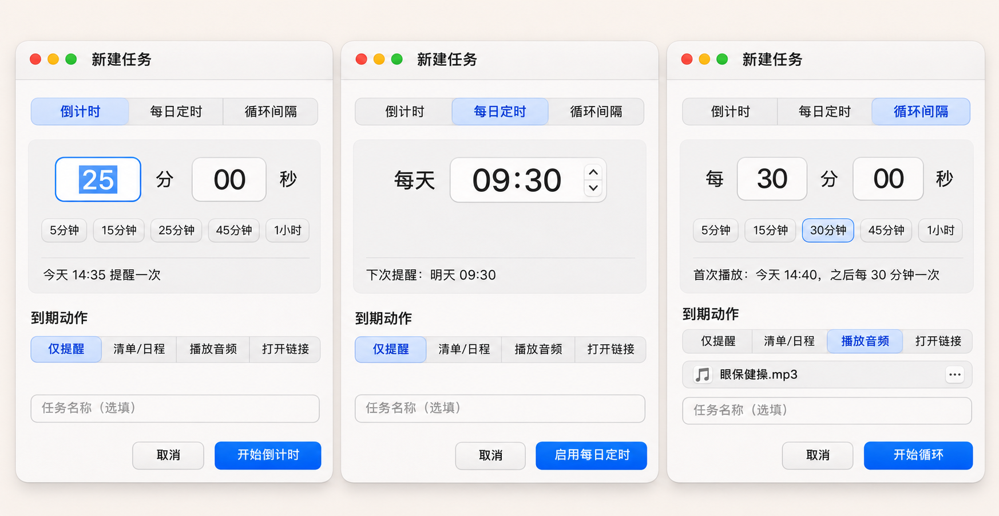
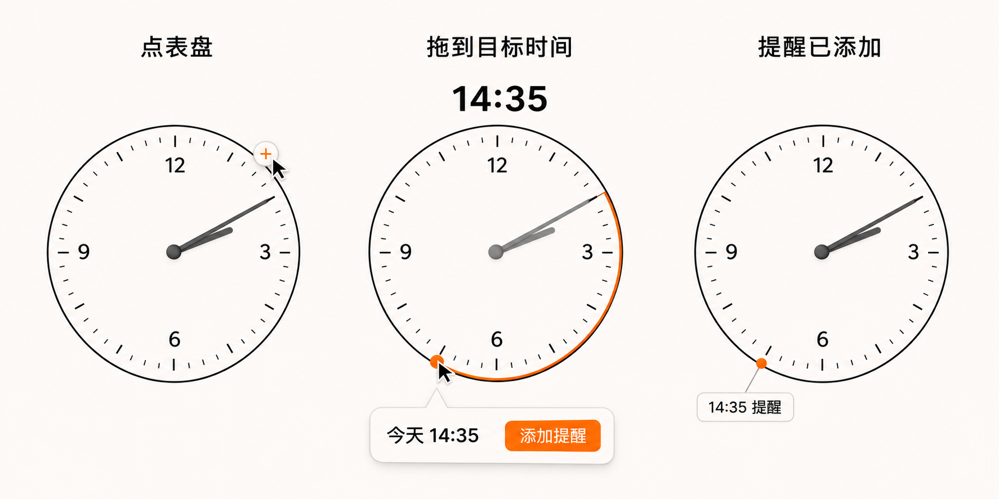

<div align="center">


# It's Time for Mac

**专为专注与日常节奏打造的 macOS 原生极简定时自动化助手**

轻量常驻 · 原生毛玻璃质感 · 定时音频平滑淡入淡出 · 自动打开网页 · 待办清单 HUD

[](https://www.apple.com/macos/)
[](https://swift.org)
[](https://developer.apple.com/xcode/swiftui/)
[](LICENSE)

</div>

---

## 💡 为什么选择 It's Time？

在日常办公与专注工作流中，我们常常需要：
- **番茄钟专注或眼保健操提醒**：到期平滑播放一段舒缓的本地白噪音或提示音，而不是刺耳突兀的闹铃。
- **定时打开固定工作链接**：如每天早上 09:30 准时自动唤起浏览器打开晨会页面或项目看板。
- **任务切换清单弹窗**：时间到达时，在屏幕中央轻巧浮出待办事项（Checklist），帮助思绪快速着陆。
- **安静陪伴无感常驻**：绝不打扰正常工作，常驻菜单栏，极低资源占用。

**It's Time** 正是为此而生：完全采用 Swift 与原生 SwiftUI 构建，深度契合 macOS 人机交互指南与半透明毛玻璃材质，提供直观平缓的时间管理体验。

---

## 📸 界面预览

### 1. 多元定时模式与到期动作
支持**倒计时（番茄钟）**、**每日定时**与**循环间隔**三种时间模式，并可自由配置**仅系统提醒**、**清单/日程弹窗**、**播放本地音频**及**打开指定链接**。

<div align="center">
  
</div>

<br/>

### 2. 拟物化表盘交互
通过直观的时钟表盘点击与圆弧拖拽，快速设定目标提醒时刻，带来符合直觉的交互手感。

<div align="center">
  
</div>

---

## ✨ 核心特性

### ⏰ 灵活强大的触发模式
* **倒计时触发（Countdown）**：预置 5m、15m、25m（标准番茄钟）、45m、1h 等快捷按钮，支持秒级精确自定义与实时暂停/继续/重置。
* **每日固定时刻（Daily Scheduled）**：设置每天特定时间点唤起（如工作日 09:30 晨会提醒）。
* **循环周期触发（Interval Loop）**：设定固定周期间隔自动提醒（如每隔 45 分钟提醒站立饮水）。

### 🎯 丰富的到期执行动作
* **🎵 本地音频平滑播放**：
  * 支持拖拽或选择 `.mp3`, `.wav`, `.m4a`, `.aiff`, `.flac` 等主流格式。
  * **平滑淡入/淡出（Fade In/Out）**：触发时音频缓缓淡入，停止时自然渐弱，避免惊吓或打断深度心流。
  * **提前 3 秒预告（Audio Pre-Alert HUD）**：在播放前提供轻量温和提醒。
  * **防休眠保障**：播放期间自动通过系统底层阻止休眠，保障音频不被截断。
* **🌐 自动打开网页链接**：
  * 自动补全 URL 为规范的安全链接，到期唤起系统默认浏览器。
* **📋 任务清单/日程浮窗（HUD）**：
  * 到期在屏幕中央弹出专属待办卡片，支持勾选确认。
* **🔔 系统原生通知**：支持标准的 macOS 系统横幅提示与声音。

### 🎨 原生双形态设计与神经多样性友好
* **双形态操作界面**：
  * **菜单栏常驻面板**：常驻顶部状态栏，实时展示当前最先到期的倒计时，单手点击即呼出快捷控制卡片。
  * **独立主管理窗口**：提供时间轴带（Timeline Ribbon）全天排期视图与详尽的任务卡片管理。
* **神经多样性友好（Neurodiversity Friendly）**：
  * 剔除眩目多余的高频动画与跳跃动效。
  * 严格规范的层级对比与间距，信息结构一目了然。
  * 全面抑制系统多余的焦点框干扰，提供纯净的专注空间。

---

## 🛠️ 安装与运行

### 方式一：直接运行已编译版本
本项目已预置构建完成的原生应用产物：
```bash
open "It's Time.app"
```

### 方式二：从源码构建

#### 环境要求
- macOS 13.0 (Ventura) 或更高版本
- Xcode 15.0+ 或 Swift 5.9+ 工具链

#### 一键打包脚本
克隆项目后，在根目录直接执行打包脚本：
```bash
git clone https://github.com/simpfly/auto-timer-mac.git
cd auto-timer-mac
chmod +x build_app.sh
./build_app.sh
```
打包脚本将自动使用 Release 模式编译 Swift 代码、合成 `.icns` 矢量图标、生成符合 Apple 规范的 `It's Time.app` 包体。

---

## 📂 项目结构

```text
auto-timer-mac/
├── Sources/
│   └── itstime/
│       ├── ItsTimeApp.swift            # 应用生命周期入口与代理
│       ├── StatusItemManager.swift     # 菜单栏常驻管理与 Popover 控制
│       ├── MainWindowView.swift        # 主任务列表与时间轴管理窗口
│       ├── MenuBarView.swift           # 菜单栏展开微型面板
│       ├── TaskEditorSheet.swift       # 任务创建与高级参数编辑弹窗
│       ├── ClockVisualizerView.swift   # 拟物化时钟交互与表盘拖拽
│       ├── TimelineRibbonView.swift    # 24小时横向排期时间轴带
│       ├── SchedulerEngine.swift       # 定时触发核心引擎与持久化
│       ├── AudioService.swift          # 音频播放、平滑淡入淡出与音量控制
│       ├── SleepPreventionService.swift# macOS 系统防休眠断言保障
│       └── GlassStyles.swift           # 原生毛玻璃材质与视觉组件库
├── Resources/                          # 资源与系统配置
├── assets/                             # README 所需图标与高清截图
├── Package.swift                       # Swift Package Manager 配置文件
├── build_app.sh                        # 自动化 Release 打包与 App 组装脚本
└── generate_icon.swift                 # Raycast 风格应用图标生成脚本
```

---

## 📄 开源许可证

本项目基于 [MIT License](LICENSE) 许可证开源。
