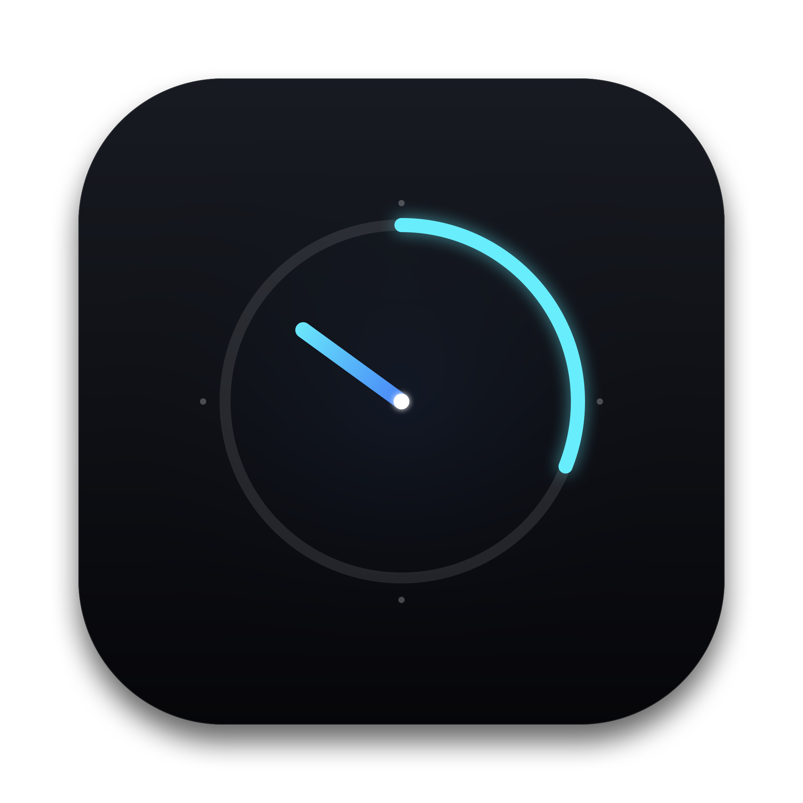
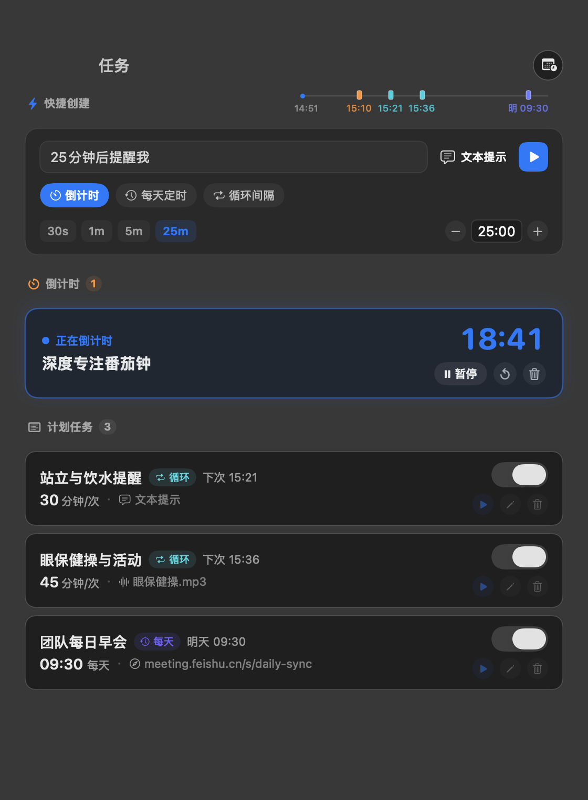

<div align="center">



# It's Time for Mac

**专为专注节奏打造的 macOS 原生极简定时自动化助手**

极简常驻 · Linear 风格暗黑美学 · 全内联零弹窗创建 · 流式全天时间轴 · 声音与平滑音频 · 日历深度联动

[](https://www.apple.com/macos/)
[](https://swift.org)
[](https://developer.apple.com/xcode/swiftui/)
[](LICENSE)

</div>

---

## 📸 界面预览

### 1. 独立主任务管理窗口
集成**全内联快捷创建**、**全天流式时间轴带**、**专注倒计时看板**以及**计划任务卡片列表**，提供清晰的三级视觉层次与纯净的暗黑毛玻璃质感。

<div align="center">
  
</div>

<br/>

### 2. 菜单栏常驻控制台
常驻 macOS 顶部菜单栏，极低功耗。点击即呼出紧凑控制面板，快速创建任务、掌控当前进行中的倒计时与多项计划。

<div align="center">
  
</div>

---

## ✨ 核心特性

### ⚡ 全内联快捷创建（零弹窗交互）
摒弃繁琐的弹窗与多层抽屉，直接在面板中就地创建与即时编辑任务：
* **智能单行直达**：输入任务描述（如“25分钟后提醒我”），一键快速启动。
* **三大触发模式**：
  * **⏱️ 倒计时（Countdown）**：快捷预设 `30s`、`1m`、`5m`、`25m`（番茄钟），支持秒级精确加减与实时暂停/恢复/重置。
  * **⏰ 每天定时（Daily Scheduled）**：设置每日固定时刻（如工作日 09:30 团队晨会）。
  * **🔁 循环间隔（Interval Loop）**：设置固定周期重复触发（如每隔 30 分钟饮水提醒、每隔 45 分钟眼保健操）。
* **四大正交执行动作**：
  * **💬 文本提示**：到期在屏幕中央弹出沉浸式大字毛玻璃卡片，支持勾选确认。
  * **🔔 声音通知**：到期仅播放一声清脆系统提示音，绝不打扰沉浸式心流。
  * **🎵 播放音频**：内置眼保健操、八段锦音频，或选择本地音频文件。支持**平滑淡入/淡出（Fade In/Out）**与**系统底层防休眠锁**。
  * **🌐 打开链接**：自动补全协议并唤起默认浏览器（如飞书/腾讯会议/项目看板链接）。

---

### 🌈 流式全天时间轴带（Compact Timeline Strip）
* **非等比标尺**：按事件流式排布全天所有任务节点，直观展示紧随其后的各项排期。
* **类型色彩映射**：
  * 🟠 橙色：倒计时任务
  * 🟣 靛蓝：每日固定定时
  * 🟢 蓝绿：循环间隔提醒
  * 🟪 紫色：系统日历同步日程
* **高颜值交互**：鼠标悬停任意节点，即时浮出毛玻璃微气泡，倒数精确剩余时间。

---

### 📅 系统日历与提醒事项深度联动
* 基于系统底层 `EventKit` 原生框架。
* 一键导入 macOS 系统日历日程与提醒事项，无缝融合在全天时间带中共同流转。

---

### 🧠 神经多样性友好与 Linear 暗黑美学
* **Linear 极简暗黑主题**：深曜石暗黑底色搭配冷电青与深蔚蓝流光，微光边框勾勒，不刺眼。
* **全局焦点框抑制**：彻底去除系统多余的虚线焦点圈，提供纯净视界。
* **无多余高频动画**：平缓呼吸式状态指示，减少视觉认知负荷，专注当下。

---

## 🛠️ 安装与构建

### 运行方式

#### 方式一：直接运行 App
```bash
open "It's Time.app"
```

#### 方式二：从源码一键构建
克隆代码并在项目根目录运行自带的打包脚本：
```bash
git clone https://github.com/simpfly/auto-timer-mac.git
cd auto-timer-mac
chmod +x build_app.sh
./build_app.sh
```
打包脚本会自动执行 Release 编译优化、打包高清图标资源并生成符合 macOS 规范的 `It's Time.app`。

---

## 📂 项目结构

```text
auto-timer-mac/
├── Sources/
│   └── itstime/
│       ├── ItsTimeApp.swift              # 应用主生命周期入口
│       ├── StatusItemManager.swift       # 菜单栏常驻管理与 Popover
│       ├── MainWindowView.swift          # 主管理窗口视图
│       ├── MenuBarView.swift             # 菜单栏弹出微型面板
│       ├── QuickTaskCreateView.swift     # 全内联快捷创建与就地编辑
│       ├── CompactTimelineStripView.swift# 紧凑横向流式全天时间轴带
│       ├── SchedulerEngine.swift         # 定时调度核心引擎与状态管理
│       ├── AudioService.swift            # 音频平滑淡入淡出与音量控制
│       ├── EventKitService.swift         # 系统日历与提醒事项同步服务
│       ├── SleepPreventionService.swift  # 系统底层防休眠断言保障
│       └── GlassStyles.swift             # 原生毛玻璃修饰符与视觉库
├── Resources/                            # 内置提示音与音频资源
├── assets/                               # README 高清图标与真实截图
│   ├── icon.png                          # Linear 风格高清应用图标
│   └── screenshots/
│       ├── main-window.png               # 真实主窗口管理界面截图
│       └── menubar-panel.png             # 真实菜单栏常驻面板截图
├── Package.swift                         # Swift Package Manager 配置
└── build_app.sh                          # 自动化构建与 App 打包脚本
```

---

## 📄 许可证

本项目采用 [MIT License](LICENSE) 许可证开源。
