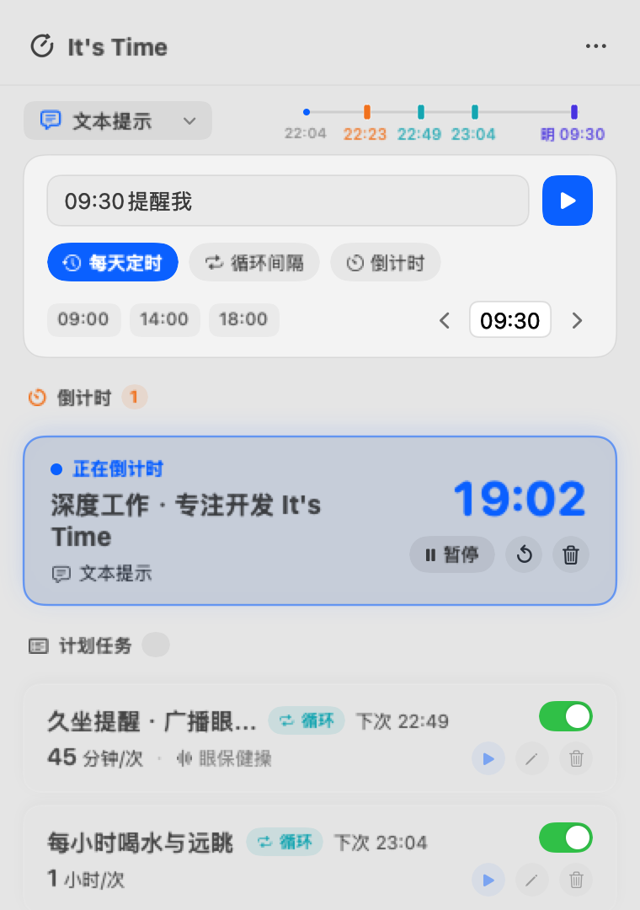

<div align="center">


# It's Time

**专为专注节奏打造的 macOS 原生极简定时自动化助手**

开箱即用 · 菜单栏常驻 · 零弹窗全内联 · 全天流式时间轴 · 场景化定时联动

[](https://www.apple.com/macos/)
[](https://swift.org)
[](https://developer.apple.com/xcode/swiftui/)
[](LICENSE)

</div>

---

## 🎯 解决的核心场景

日常在 Mac 上工作，我们经常被割裂的闹钟、打扰心流的弹窗和繁琐的设置打断。**It's Time** 从真实的办公与专注场景出发设计：

### 1. 深度心流专注（番茄钟）
* **场景**：开始一段 25 分钟的编码或写作，需要清晰的计时但拒绝多余的噪音干扰。
* **体验**：输入或点击快捷预设（30s / 25m / 60m），主窗口与菜单栏同步呈现大字高亮看板；到期可选择仅播放一声清脆铃声或居中毛玻璃大字卡片，绝不暴力打断当前工作。

### 2. 每日例会与准时接入
* **场景**：每天早上 09:30 有团队站会，或下午 15:00 有线上方案评审。
* **体验**：设定固定时刻与会议链接（腾讯会议/飞书/Zoom），时间一到自动呼起浏览器或客户端进入会议；深度集成系统日历与提醒事项，日程自动流转呈现在全天时间轴上。

### 3. 久坐缓解与工间锻炼
* **场景**：在屏幕前一坐数小时，眼睛酸涩、颈椎疲惫。
* **体验**：开启循环间隔（如每隔 45 分钟），到期平滑播放眼保健操或八段锦音频（内置音频平滑淡入淡出、系统防休眠），结束后自动准备下一轮循环。

### 4. 零思考自然语言快速定闹钟
* **场景**：双手在键盘上打字，脑中浮现一个临时提醒。
* **体验**：在输入框直接敲“**半小时后提醒我出门**”或“**下午3点方案评审**”，自动识别倒计时或每日时刻，回车即刻开始，全内联零弹窗跳转。

---

## 📸 界面预览

### 主任务控制台
集成**全内联快捷创建**、**全天流式时间轴带**、**专注倒计时看板**以及**计划任务卡片列表**，层级分明，纯净低干扰。

<div align="center">
  
</div>

<br/>

### 菜单栏极简常驻
极低资源占用。常驻 macOS 状态栏，点击即呼出紧凑控制面板，随时掌控进行中的倒计时与待触发计划。

<div align="center">
  
</div>

---

## ⚡ 特性速览

| 能力 | 说明 |
| :--- | :--- |
| **三大触发模式** | **每天定时**（固定时刻）、**循环间隔**（周期提醒）、**倒计时**（番茄钟与秒级微调） |
| **四大到期动作** | **文本提示**（中央毛玻璃大字）、**声音通知**（清脆短铃）、**播放音频**（本地/内置操曲淡入淡出）、**打开链接**（自动唤起网页或会议客户端） |
| **流式时间轴** | 紧凑非等比彩色标尺，悬停即时显示剩余倒数与全天排期 |
| **系统日历联动** | 原生 `EventKit` 深度对接系统日历日程与提醒事项，一键无缝导入 |
| **防休眠保障** | 播放长音频时自动开启系统防休眠锁，播放完毕或暂停即刻释放 |

---

## 🛠️ 安装与运行

### 方式一：直接运行独立应用
1. 克隆代码仓库：
   ```bash
   git clone https://github.com/simpfly/its-time-mac.git
   cd its-time-mac
   ```
2. 执行打包脚本：
   ```bash
   ./build_app.sh
   ```
3. 打开生成好的 `It's Time.app`（或直接拖入 `/Applications` 应用程序目录）：
   ```bash
   open "It's Time.app"
   ```

### 方式二：开发者调试
使用 Swift Package Manager 原生构建：
```bash
swift build
swift test
```

---

## 📄 开源协议

本项目基于 [MIT](LICENSE) 协议开源。
